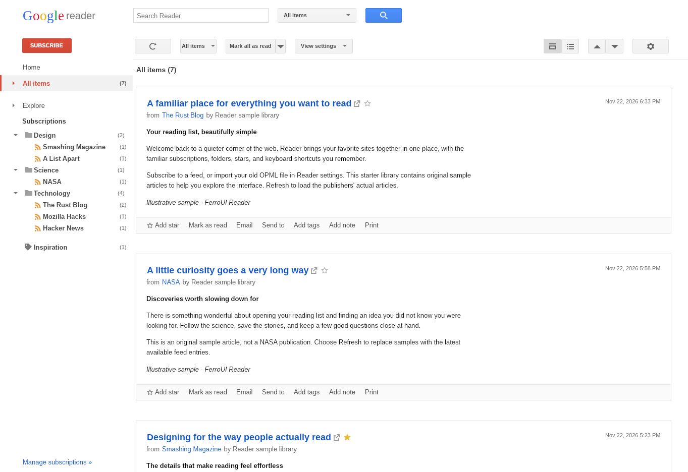

# FerroUI Reader

A feed reader in Rust that recreates Google Reader's final desktop interface with **FerroUI**. The browser and desktop hosts run the same declarative `rsx!` views, Material-based control themes, ReactiveUI view model and DynamicData article projections.

**Live application:** [ferroui.com/Reader](https://ferroui.com/Reader/) · [Pages alias](https://ferroui.github.io/Reader/) · [Build and publish](https://github.com/FerroUI/Reader/actions/workflows/pages.yml)

The workflow publishes successful builds from `main`; the deployment job is the source of truth for the currently published revision. This repository implements the core reading and subscription workflows. It does **not establish 100% visual or feature parity** with the retired Google service. [Fidelity and feature coverage](docs/parity.md) distinguishes the implemented experience, adaptations and remaining gaps. [Reference research](docs/reference.md) records preserved original CSS, JavaScript, screenshots and official feature announcements.



Actual browser verification captures: [Home](docs/screenshots/home.png) · [Expanded reading](docs/screenshots/expanded.png) · [Narrow layout](docs/screenshots/narrow.png). See the [verification record](docs/verification.md) for the tested revision, interaction checks and measured control counts.

## What you can do

- Read All items, individual subscriptions, folders, starred items and tags, in expanded or list view. Open a row in place, move between articles, keep an item unread, star it, edit tags and add a private note.
- Choose **Read full article** to load the publisher's article inside Reader. Switch back to **Feed content**, reload a saved copy, cancel a download or retry an inline error. Downloaded text is saved locally for offline reading, search, printing and JSON backups. See [article reading](docs/article-reading.md) for connection and publisher limits.
- Subscribe to RSS, Atom and JSON Feed addresses, or discover a feed from an accessible website. Refresh subscriptions, rename them, create/rename folders, assign several folders, drag subscriptions between folders or reorder them, and unsubscribe.
- Open a folder's actions with right-click, Shift+F10, a touch hold or **Folder settings**. Refresh that folder without leaving the current article, rename it, delete only its label, or unsubscribe from its subscriptions in one confirmed, undoable operation. A confirmation becomes unavailable if the folder's membership changes while it is open.
- Unsubscribing preserves starred, tagged and noted articles together with their source metadata. Find them through Starred, tags or saved-library search; re-subscribe through the source's **Subscribe again** action. Unsubscribed sources stay out of the subscription tree, refresh queue, ordinary reading list and OPML exports. JSON backups retain the saved items and their source metadata.
- Switch between all and unread items, sort newest or oldest first, and retain each stream's reading preferences. Mark a stream read, including items older than one day, one week or two weeks.
- Search saved article text, titles, authors, feed names, tags and notes. Query operators include `is:unread`, `is:starred`, `feed:`, `author:`, `title:`, `tag:`, `before:` and `after:`; quoted phrases and excluded terms are supported.
- Import and export OPML subscriptions with folders. Export or restore a complete JSON library containing cached articles, read state, stars, tags, notes and preferences. Undo recent library changes.
- See local reading totals, a 30-day activity chart and per-subscription reading percentages. Browse a small explicit starter catalog in Explore.
- Choose Comfortable, Cozy or Compact density, a saved base article text size and a start page. Magnify the current article from 100–150% with `+`/`-` or its View/Feed settings menu; hide the desktop sidebar to let the article body use the available width. Use keyboard navigation, subscription/tag jump dialogs, a collapsible subscription pane and a reading focus mode. At narrow widths the sidebar becomes an overlay; browser Back dismisses it or an open dialog before leaving the stream. Touch targets adapt to a coarse primary pointer, and the host respects safe areas and the visible keyboard viewport.
- Open original articles, copy their links, invoke the browser's sharing interface where supported, open an email draft and print an article.
- Keep a local library between launches. The browser caches the application for offline use after a complete successful installation; already saved article text remains readable offline.

### Real subscriptions on first use

A fresh library starts with six real subscriptions and fetches their articles on first use. Reader does not bundle invented stories or publish an illustrative feed session.

| Folder | Default subscriptions |
| --- | --- |
| Technology | Hacker News, Ars Technica, The Verge |
| Development | Rust Blog, GitHub Blog |
| News | BBC News |

The articles come from each publisher through the normal feed connection. If a connection fails or you are offline, the subscription remains available to refresh when you reconnect. You can unsubscribe, move or rename any default feed, add your own subscriptions, or import OPML. First-use setup does not overwrite an established user library or refill a library you have intentionally emptied. The [default feed addresses and connection guide](docs/feed-connection.md#default-subscriptions) describe the sources and browser transport.

### Reading on a phone or tablet

The narrow layout keeps Previous, reading mode and Next along the bottom edge. Tap a headline or its date to expand or collapse a list item in place. Its compact headline remains above the article body. Stars and the original-link button remain independent actions with touch-sized targets. A vertical drag scrolls without opening the item where the gesture began; cancellation, a second finger or moving away and returning also cancel a pending tap.

Open subscriptions with the menu button. Hold a subscription and release without moving to open its actions; move after holding to reorder it or move it to another folder. A blue line previews the insertion point, and a held drag near the sidebar edge scrolls the list. Reordering within a folder retains the subscription's other folder memberships. The order is shared across folder views. Hold a folder and release without moving to open its own actions; moving or cancelling the hold does not open the folder or execute an action.

Browser Back closes a menu, dialog or subscription drawer before leaving the current stream. Menus and footer actions have larger touch targets, and dialogs fit small portrait, landscape and reduced keyboard viewports. Search advertises a Search keyboard/action; subscription URLs advertise URL entry and Go. The host supplies those hints without replacing the native editor or its composition/selection state. Browser pinch magnification remains available.

These are verified Chromium interaction paths and a responsive adaptation of desktop Reader. Physical iOS keyboard behavior and the separate original Google Reader mobile application's complete visual parity have not been verified. The [verification record](docs/verification.md) gives the exact tested viewports and limits.

## Build and run the browser app

Install Git, Rust through rustup, Node.js 24 with npm, Python 3 and a native C/C++ build toolchain. The canonical [FerroUI browser setup](FerroUI/scripts/browser/setup.sh) supports Linux and macOS and installs its pinned browser tools into the directory you select.

```bash
git clone --recurse-submodules https://github.com/FerroUI/Reader.git
cd Reader
bash FerroUI/scripts/browser/setup.sh "$PWD/.tools"
source .tools/env.sh
bash scripts/build-browser.sh
python3 -m http.server 8080 --directory target/browser/reader-browser
```

Open [localhost:8080](http://localhost:8080/). Serve the output through HTTP; opening `index.html` as a local file does not provide the browser capabilities the app needs.

The UI target is **`wasm32-unknown-emscripten`**. Article extraction uses a separate **`wasm32-unknown-unknown`** Web Worker module, built by the same wrapper and loaded on demand. The pinned framework uses Rust **1.99.0**, Emscripten **6.0.10** and wasm-bindgen **0.2.129**. The setup script and checked-in toolchain select matching versions. The build wrapper delegates UI compilation and web runtime generation to FerroUI, stages the extractor and shared fonts, then generates a content-derived build identifier, offline manifest and `.nojekyll`.

Useful options pass through to FerroUI's builder:

```bash
bash scripts/build-browser.sh --debug
bash scripts/build-browser.sh --out target/site
```

The default deployment uses the normal single-threaded browser profile. FerroUI's optional threaded builds have additional toolchain and cross-origin-isolation requirements; GitHub Pages is not configured to provide those headers.

### Connecting live feeds

Use **Subscribe**, enter a feed or website address, and choose **Add**. Bare addresses such as `example.com/feed.xml` use HTTPS. A desktop popup opens below Subscribe; touch layouts use a dialog.

The default **Automatic** connection tries the publisher directly. If the browser cannot connect or the request times out, eligible public RSS/Atom feed URLs can be fetched through **rss2json**, without configuring an API key. An existing saved custom proxy takes precedence over that public service. JSON Feed remains supported directly or through a custom raw proxy.

Choose a policy under **Reader settings → Feed connection**, then select **Save feed connection**. Connection changes remain a draft until validation succeeds; the dialog identifies unsaved changes and shows errors beside the URL. Enter in that field saves a valid draft:

| Policy | Behavior |
| --- | --- |
| Automatic | Direct request, then the saved custom proxy or rss2json |
| Direct only | Publisher requests only; the saved proxy is retained but unused |
| Custom proxy | Direct request, then your validated raw-response endpoint containing `{url}` |

The public service receives requested feed URLs and may cache or limit returned items; it also has provider quotas. Use Direct only or your own trusted endpoint for private feeds. Blocked website HTML may require its actual RSS/Atom address; an accessible page or custom raw proxy supports feed autodiscovery. [Connection setup, privacy, provider limits and troubleshooting](docs/feed-connection.md) explains the behavior and the official sources.

GitHub Pages hosts static assets and cannot make a publisher return CORS headers. Reader therefore uses a separate feed service when direct access fails; it does not provide a Google-style crawler or historical archive. Downloads are bounded, visible HTTP/size/encoding failures retain their actual cause, and a failed subscription does not create a placeholder feed. Existing saved articles remain intact. The desktop host fetches directly and ignores the browser connection policy.

### Storage and offline operation

The browser stores the library in the `ferroui-reader` IndexedDB database. Writes use a transaction and a generation check to detect another tab's changes. When IndexedDB is unavailable, a localStorage fallback is used; that fallback does not provide the same cross-tab transaction guarantees. A conflicting tab asks you to export its backup and reload instead of replacing another tab's saved state.

Malformed saved data is retained in a recovery copy when storage allows it. If that copy cannot be written, normal writes are blocked to protect the original. Storage errors are shown in the application. **Import/Export → Download backup** produces a portable complete library; OPML only carries subscriptions and folders. Restoring a JSON backup replaces the current library after validation, while importing OPML merges subscriptions.

The service worker verifies the size and SHA-256 of every application asset against the build manifest before completing installation, including the stamped index, WASM and fonts. Downloads bypass stale HTTP-cache entries and a failed new installation preserves the prior cache. These cache-integrity paths have focused tests; the strengthened browser reload/offline gate is tracked separately in [verification.md](docs/verification.md). The worker does not cache every publisher image or fetch new articles while offline. A fully downloaded update offers **Update Reader** and **Later** in a native notification. Update Reader first saves the library, asks you to close any other Reader tabs, then activates the waiting snapshot and reloads this tab. A storage conflict or failed save keeps the current page available. Later lets you continue reading; normal close/reopen activation also remains available. For development, `?nooffline=1` prevents registering a worker; if an older worker already controls the origin, unregister it through your browser's application tools before checking changed assets.

## Run the desktop host

The native host uses FerroUI's platform detection, Skia renderer, system clipboard, storage picker and launcher integrations. Install the corresponding [FerroUI platform prerequisites](FerroUI/README.md#getting-started), including the native graphics/text dependencies. On Linux this host selects X11 and needs a reachable X server or XWayland plus the platform libraries described in [FerroUI's X11 guide](FerroUI/docs/porting/x11-platform.md). macOS and Windows use their respective FerroUI backends. Platform dialogs and launcher availability depend on those native integrations.

Install `curl` on `PATH` for feed and image retrieval. Network work runs on a bounded background worker pool; parsing results return through the UI dispatcher.

```bash
cargo run --locked -p reader-desktop --profile fast-release
```

The library is stored as `reader.json` under the platform application-data directory:

| Platform | Default directory |
| --- | --- |
| Linux | `$XDG_DATA_HOME/FerroUI/Reader`, or `~/.local/share/FerroUI/Reader` |
| macOS | `~/Library/Application Support/FerroUI/Reader` |
| Windows | `%LOCALAPPDATA%\FerroUI\Reader` |

Set `READER_DATA_DIR` to use a different directory. Saves are coalesced on a dedicated worker and replace the file only after a complete temporary file is written and synchronized. Closing waits for pending writes. A save failure keeps the window open once and offers a chance to export a backup before exiting. Use one native process per data directory; there is no native cross-process merge protocol.

Desktop sharing copies an article title and link for pasting into another application. Email opens a `mailto:` draft. Printing opens a local text preview in the default browser. These are local platform integrations, not the former Google sharing or email service. Desktop feed decoding currently requires UTF-8; the browser host also honors supported XML/HTTP text encodings.

## Keyboard essentials

Shortcuts apply outside text inputs. Press `?` for the in-app reference.

| Keys | Action |
| --- | --- |
| `j` / `k` | Open next / previous article |
| `n` / `p` | Move the article cursor without opening |
| `Shift+n` / `Shift+p` (`Shift+j` / `Shift+k`) | Move the subscription-tree cursor without opening |
| `Shift+o` / `Shift+x` | Open the cursor's stream / toggle its folder or parent folder |
| `o` / `Enter` | Expand or collapse the selected row |
| `Space` / `Shift+Space` | Next / previous article when its edge is visible; otherwise page with 50 pixels of overlap |
| `s`, `m`, `t` | Toggle star, toggle read state, edit tags |
| `v`, `e` | Open original article, prepare email |
| `Shift+s` / `Shift+t` | Share through the host / open the configured Send to menu |
| `Shift+a`, `r` | Mark stream read, refresh subscriptions |
| `1` / `2` | Expanded / list view |
| `g` then `h`, `a`, `s` | Home, All items, Starred |
| `g` then `t` / `u` | Choose a tag or folder / choose a subscription |
| `g` then `Shift+t` | Trends |
| `g` then `d` / `e` | Explore subscriptions |
| `+` / `-` | Increase / decrease article text size |
| `/`, `a` | Focus search, add a subscription |
| `u`, `f` | Toggle subscriptions, toggle reading focus |
| `Escape` | Close the dialog or selected entry |
| `Ctrl+z` / `Cmd+z` | Undo a recent library change |

The subscription cursor follows visible feeds, folders and tags independently of the open article stream, without wrapping. Shift+O opens it; Shift+X toggles its folder or a feed's parent folder. At the end of the final article, Space opens the next unread subscription occurrence without wrapping to earlier feeds. Search fields, editors, focused buttons and inline links retain their native keyboard behavior. There is no Popular items destination (`g p`). The complete historical map in [reference.md](docs/reference.md) is a fidelity target; [parity.md](docs/parity.md) records the remaining differences.

### Custom Send to destinations

Open **Reader settings → Customize Send to** to create, edit, enable or remove destinations. A destination has a name and an HTTPS URL template, for example `https://example.com/save?url=${url}&title=${title}&source=${source}`. Reader encodes the article address, title and subscription name separately before inserting them. The destination host stays fixed; templates cannot execute scripts or supply embedded credentials.

Enabled destinations appear in each expanded article's **Send to** menu. **Shift+T** opens that menu for the current cursor item, including a collapsed list item; with no enabled destinations it opens configuration. Choosing a destination opens its URL through the browser or desktop launcher. Opening the menu or editing preferences does not send anything. Destinations are included in the normal saved library and JSON backup.

This is separate from **Share** / **Shift+S**, which uses the supported host sharing interface. No retired Google service endpoints are preconfigured. The portable template supports `${url}`, `${title}` and `${source}`; historical body/shortener/escaped-field templates and service icons remain outside the implemented subset.

## Architecture and checks

| Crate | Responsibility |
| --- | --- |
| `reader-domain` | Serializable models, validated actions, feed parsing, search, OPML and backup documents |
| `reader-state` | ReactiveUI commands, DynamicData caches, counts, navigation, stream preferences and undo |
| `reader-content` | Bounded native content projection and optional shared HTML5/Readability extraction |
| `reader-extract` | Independent Web Worker WASM module for publisher extraction |
| `reader-controls` | Trimmed Material base, Reader styles, reusable templates and vector icons |
| `reader-ui` | Shared RSX shell, virtualized article rows, menus, dialogs, keyboard and drag interactions |
| `reader-fonts` | Shared font registration and licensed Liberation font assets |
| `reader-browser` | Browser lifetime, WASM exports, network/storage bridge, navigation, files and offline shell |
| `reader-desktop` | Native lifetime, background transport, atomic file storage and platform services |

Read [architecture.md](docs/architecture.md) for data flow, retained controls, performance decisions and host boundaries.

```bash
cargo test --locked -p reader-domain -p reader-state -p reader-content --features reader-content/extraction
node --test scripts/*.test.mjs
cargo check --locked -p reader-desktop
```

The tests cover domain and view-model invariants and focused browser-host behavior. They do not certify every original screen, pixel, browser or native operating system. The ordinary Pages workflow runs the first two commands, four pure gesture checks, five tree-cursor checks and two native request-operation checks, then builds one browser target without a platform matrix or native packaging gate. [Verification status](docs/verification.md) records executed rendered-browser checks, their exact revision, inspected visual corrections, measured control counts and offline-reload evidence. The optional suite also defines a true cross-origin feed scenario; a scenario's definition alone does not establish a passing result.

### Optional rendered-browser verification

After building the site, install Chrome or Chromium and run:

```bash
node scripts/ui-smoke.mjs target/browser/reader-browser target/ui-smoke
```

The harness serves the built application locally and launches a **fresh isolated Chromium profile**. It does not reuse your signed-in browser, feed library or service-worker cache. Set `CHROME` to the browser executable if automatic discovery cannot find it. Node.js 24 is sufficient; no Playwright or browser-testing package is required.

The requested checks exercise first paint, actual control input, reading/annotation shortcuts, search and keyboard hints, feed subscription, settings, reload persistence, conflicting storage writers, touch scrolling/cancellation, in-place opening, held menus, subscription reordering/folder movement, browser Back, small/landscape/keyboard-sized dialogs, automatic reading state, a 10,000-article virtualization fixture and offline reload. Additional scenarios cover full-article extraction, cached feed/full switching, cancellation, error recovery, code/table overflow, mobile offline reading, 1,200 heterogeneous articles, far seeks and delayed-image paragraph anchoring. A separate fixture publisher omits CORS headers, so the cross-origin scenario requires the configured relay, discovers a relative feed from HTML and checks refresh identity and failure reporting. PNG screenshots, control-tree JSON and a success report or failure evidence are written to `target/ui-smoke`. A passing scripted run is evidence for those exercised paths, not complete historical visual parity.

To request this gate in GitHub Actions, include **`[verify-ui]`** in the pushed commit message or manually dispatch **Build and publish** with **`verify_ui: true`**. The workflow runs the browser script after compilation and uploads **`reader-ui-verification`** with a seven-day retention period, including available failure evidence. A failed requested gate blocks that run's deployment. Ordinary `main` pushes keep the domain/state + JavaScript checks, build and deploy path.

## Framework pin and deployment

`FerroUI/` is a Git submodule pinned to [`0f5bbb50dd40522f911826efe0bc3df6e968b884`](https://github.com/wieslawsoltes/FerroUI/commit/0f5bbb50dd40522f911826efe0bc3df6e968b884). Framework dependencies resolve to paths in this checkout. Recover a missing checkout with:

```bash
git submodule update --init --recursive
```

An intentional framework upgrade should update the gitlink, generated workspace dependency block and lockfile together:

```bash
git submodule update --remote FerroUI
python3 FerroUI/scripts/apps/sync-workspace.py
cargo update --workspace
bash scripts/build-browser.sh
```

The [Pages workflow](.github/workflows/pages.yml) runs on application pushes to `main` and manual dispatch; documentation-only pushes skip the build. It caches the Emscripten SDK, wasm-bindgen tool and Cargo compilation outputs, keyed by the framework revision, toolchain and build inputs. After the small behavior checks and actual FerroUI browser build, it runs rendered-browser verification only when requested, uploads `target/browser/reader-browser` and deploys through GitHub's Pages actions. Set repository Pages publishing to **GitHub Actions** when using a fork. GitHub Pages hosts only static assets; it does not provide account synchronization or feed transport services.

## Fidelity and licensing

The interface targets the final 2011–2013 desktop design, using measurements from the [preserved original client](https://readerisdead.com/reader/view/). Fonts, rendering, several dialogs, Home/Explore, chart detail, HTML projection and narrow layouts differ. Google's account service, historical feed archive, global search, proprietary ranking, recommendations, translation, subscriber statistics and Google+ integration are unavailable here. [parity.md](docs/parity.md) is explicit about these boundaries.

Application code is [MIT licensed](LICENSE). FerroUI retains its own license and third-party notices. Bundled Liberation fonts are distributed under the [SIL Open Font License](crates/reader-fonts/assets/fonts/OFL.txt). This is an independent recreation; Google Reader and Google branding belong to their respective owners.
